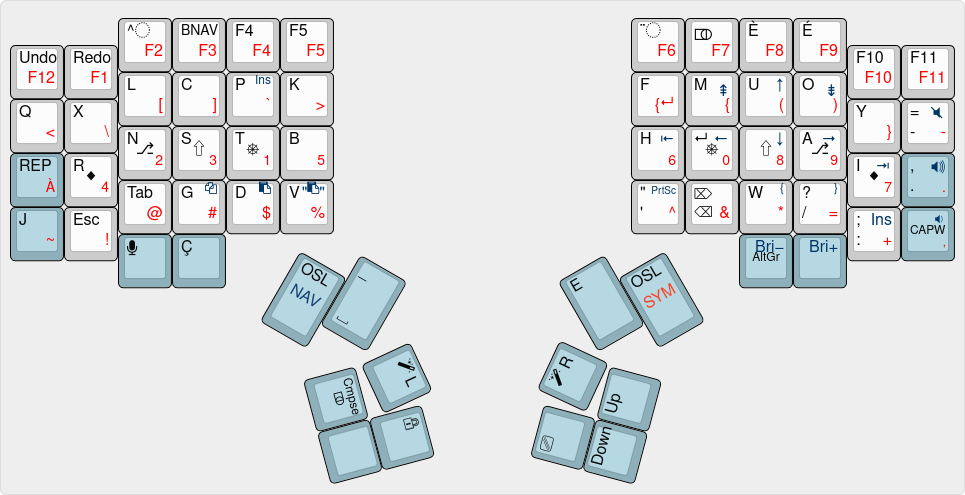

## Precondition's keymap for the Dactyl Manuform 5x6
To be inserted in ~/qmk_firmware/keyboards/handwired/dactyl_manuform/5x6/keymaps/precondition

Figure 1. Base layer legends in black, SYM layer legends in red, and NAV layer legends in blue. Unlike the ASCII art inside keymap.c, this figure is not automatically generated and may thus go out of date.

This keymap uses XYLOCUP, a totally deranged keymap I designed based on years of real keylogs fed into [jalo](https://github.com/tiagowright/jalo) with a custom set of metrics and weights. Yes, the right hand home row with enter and a dedicated one-shot shift (not a modtap) looks crazy but it actually makes a lot of sense for my terminal-heavy usage of computers. For use in English, French, and programming.

Notably, [home row mods](https://precondition.github.io/home-row-mods) are used, as well as combos and [magic keys](https://layouts.wiki/reference/terminology/magic/) on the thumbs (`MAGIC_L` and `MAGIC_R`, see `magic_thumb_keys.c`).

The main use case for magic keys is to eliminate same-finger bigrams (SFB) and same-finger skipgrams (SFS). There are also several magic sequences that type out multiple characters at once like <kbd>Space</kbd> <kbd>MAGIC_L</kbd> producing “␣the” because the most frequent n-gram that follows space by far is “the”.

Keymap visualisation diagrams are automatically generated with the help of [keymapviz] every time I compile.

[keymapviz]: https://github.com/yskoht/keymapviz

### Keymap Tricks
This keymap contains many nifty QMK tricks that can inspire you for your own keymap. Here's a non-exhaustive list.

1. Home row mods: All the modifiers on the home row.
2. `CAPS_WORD_LOCK`: Capitalizes the next word you type and then automatically toggle off Caps Lock. Perfect for typing all-caps IDENTIFIERS in code. This is a hand-rolled version of [Caps Word](https://docs.qmk.fm/#/feature_caps_word) that works on the basis of Caps Lock, unlike the core QMK feature which is based on weak Shifts. That makes it easier to keep track of its state and better handles corner cases with less firmware size.
3. Magic keys (`MAGIC_L` and `MAGIC_R`): Two thumb keys whose output depends on the previous keys. By default, they type the home row key of the finger that typed the previous key, which eliminates same-finger bigrams. On top of that, context-specific rules defined in `magic_thumb_keys.c` avoid other awkward n-grams and shorten common ones (e.g. <kbd>G</kbd><kbd>MAGIC_L</kbd> types « git␣ »).
4. `QK_REP`: QMK's [Repeat Key](https://docs.qmk.fm/features/repeat_key) repeats the last (modified) keystroke. This is used to eliminate the same-finger use that stems from double-tapping the same key. Repeating <kbd>Space</kbd> is rarely needed so it sends <kbd>Ctrl</kbd>+<kbd>T</kbd> instead, which opens fzf's file picker in the shell quickly.
5. `REP2`: Like `QK_REP` but repeats the last two keys with their modifiers (e.g. « ↓␣ » or « ⇧⇥⏎ » or « nana » as in なな).
6. Custom shift pairs: <kbd>Shift</kbd>+<kbd>.</kbd> = <kbd>,</kbd>, <kbd>Shift</kbd>+<kbd>:</kbd> = <kbd>;</kbd>, <kbd>Shift</kbd>+<kbd>-</kbd> = <kbd>=</kbd>, and <kbd>Shift</kbd>+<kbd>Backspace</kbd> = <kbd>Delete</kbd>. These are [key overrides](https://docs.qmk.fm/features/key_overrides). Also, a one-shot <kbd>Shift</kbd> followed by <kbd>Space</kbd> types <kbd>_</kbd>.
7. `LAEDER` [sic]: Sends <kbd>Compose</kbd> on Linux and <kbd>Alt</kbd> on Windows (for Alt key sequences in apps like Word), but without the special handling QMK gives to one-shot modifiers. <kbd>Shift</kbd> inverts which one is sent.
8. tmux and Vim navigation layers: `BNAV` sends tmux prefix commands to create, switch, split, zoom, and close windows and panes, while `GNAV` sends Vim's `g` motions to move through screen lines.
9. Auto escape base-layer dead keys: Automatically press space after dead keys such as '"\`^. If you're used to US intl. with AltGr dead keys on Linux but only have access to US intl. with base-layer dead keys on Windows, you'll like this. `BDED_ON` and `BDED_OF` on the ADJUST layer toggle this at run time.

### OS Setup

* OS: Xubuntu Linux
* Regional keyboard layout: English US intl. with AltGr dead keys

AND

* OS: Windows 11
* Regional keyboard layout: English US intl. (with base-layer dead keys)
